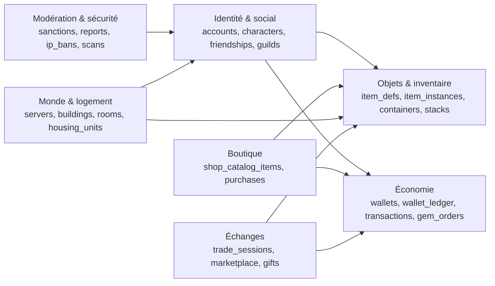
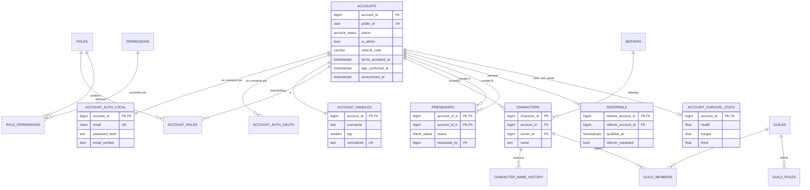
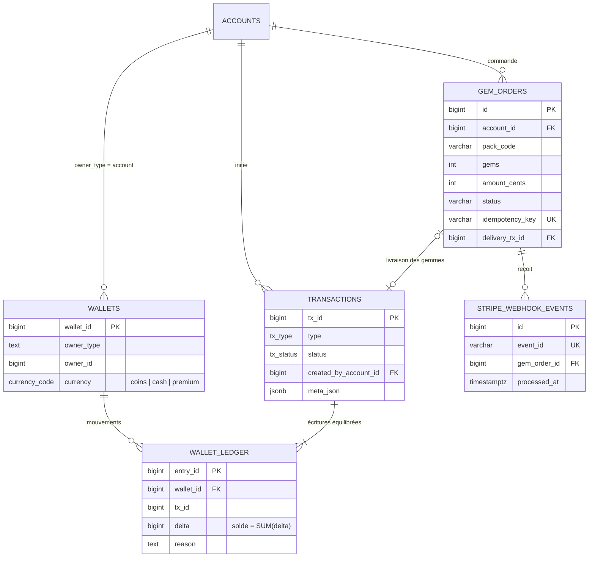
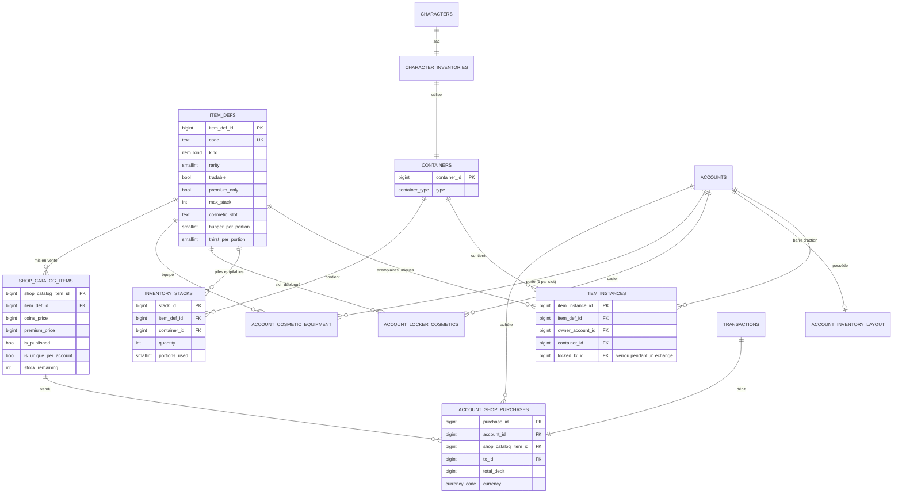
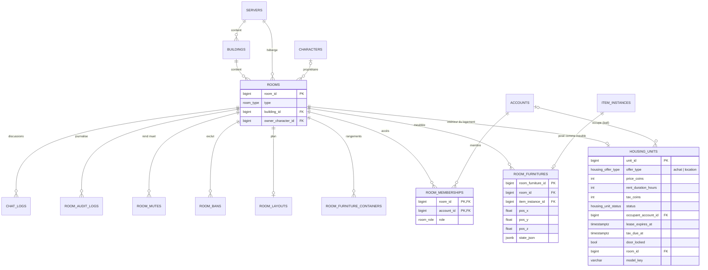
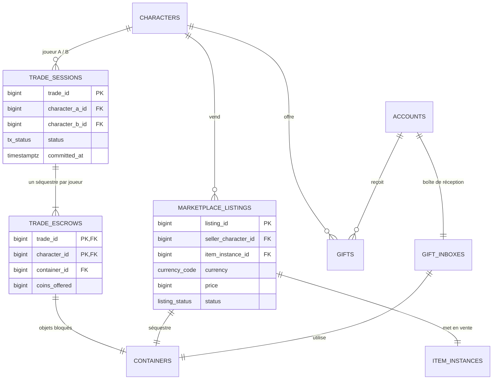
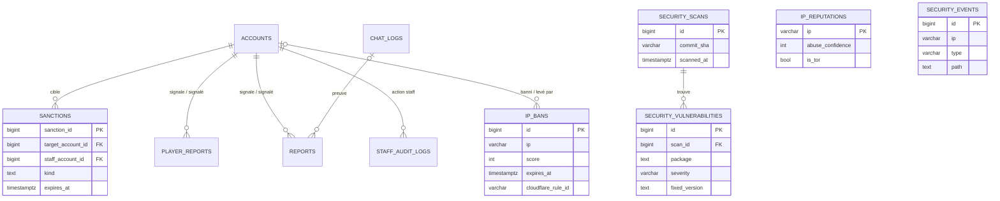

# Modèle de données

PostgreSQL 16, une soixantaine de tables. Le schéma de base vient de `backend/database/schema/campus_cove_schema.sql`, les évolutions de `backend/database/migrations/`. Les tables techniques de Laravel (`cache`, `jobs`, `sessions`, `personal_access_tokens`...) ne sont pas représentées.

Un seul diagramme serait illisible : le modèle est découpé en six domaines. Une table qui apparaît dans plusieurs domaines (souvent `ACCOUNTS`) est la même table. Seules les colonnes utiles à la compréhension sont listées.

## Vue d'ensemble

## 1. Identité & social

## 2. Économie

## 3. Objets, inventaire & boutique

## 4. Monde & logement

## 5. Échanges entre joueurs

## 6. Modération & sécurité

## Choix de conception

- **Compte et personnage séparés** : `accounts` porte l'identité, la connexion, le RGPD et l'argent ; `characters` porte la présence dans un monde (`servers`). Un compte peut avoir un personnage par serveur sans dupliquer ses achats.
- **Apparence du personnage sur le compte** : `accounts.character_sex`, `character_face`, `character_build` et `character_created_at` sont tous vides (le créateur s'ouvre) ou tous remplis (contrainte `ck_accounts_character_complete`). La couleur de peau et de cheveux reste dans `cosmetic_colors`, la coupe dans l'emplacement `hair` de `account_cosmetic_equipment`. Contrat : `docs/CHARACTER.md`.
- **Authentification à part** : `account_auth_local` et `account_auth_oauth` isolent les secrets de `accounts`. Ajouter un fournisseur OAuth ne touche pas la table principale ; l'anonymisation RGPD efface ces lignes et garde l'historique économique.
- **Argent en grand livre** : pas de colonne solde. Chaque mouvement est une ligne de `wallet_ledger` rattachée à une `transactions` ; le solde est `SUM(delta)`. Un achat, un échange ou une taxe est donc toujours traçable et auditable, et on ne peut pas « créer » de pièces en modifiant un nombre.
- **Deux monnaies, un modèle** : `currency_code` (`coins` gagnés en jeu, `premium` achetés) partage la même mécanique ; les skins premium ne se vendent qu'en `premium`.
- **Liquide et banque** : les pièces gagnées en jeu vivent dans deux portefeuilles. `cash` est l'argent sur soi : les jobs (verger, acheteurs de zone, récompenses du pub) y versent, les boutiques, le pub, les soins de la clinique et les échanges entre joueurs y prennent. `coins` est la banque : maison, taxe, hôpital et gueule de bois y sont prélevés, bonus de bienvenue et parrainage y sont versés. Dépôt, retrait et virement (`BankService`, types `bank_deposit`, `bank_withdraw`, `bank_transfer`) déplacent l'argent entre les deux. À la mort, le liquide part dans une ligne `cash_drops` (propriétaire, tueur éventuel, montant, transactions de chute et de ramassage, expiration à 5 min) que n'importe qui sauf le tueur ramasse une seule fois ; voir `docs/BANK.md`.
- **Marché de la ville** : `market_stalls` (un stand par date de marché, numéro et joueur uniques, transaction des frais), `market_lots` (un lot d'items sous séquestre sur un emplacement du stand, présenté en cagette, en panier ou à plat, statut `active`, `sold_out`, `withdrawn` ou `returned`, un seul lot actif par emplacement) et `market_sales` (une vente, `purchase_ref` unique pour qu'un achat rejoué ne passe qu'une fois, type de transaction `market_sale`). Les frais de stand ont le type `market_stall_fee` ; voir `docs/MARKET.md`.
- **Définition vs exemplaire** : `item_defs` décrit un type d'objet ; un objet unique (meuble, outil, vêtement échangeable) est une `item_instances`, un consommable est une ligne de `inventory_stacks` avec une quantité. On évite des milliers de lignes pour 99 pommes, tout en gardant un historique par meuble.
- **Conteneurs génériques** : sac, coffre de meuble, séquestre d'échange, boîte de cadeaux sont tous des `containers`. Déplacer un objet revient à changer `container_id`, avec la même logique partout.
- **Échanges sûrs** : un objet engagé est bloqué (`locked_tx_id`) et les biens passent par un séquestre (`trade_escrows`, `escrow_container_id`) ; l'échange se valide en une seule transaction SQL ou pas du tout.
- **Logement = pièce + offre** : `rooms` est l'espace jouable (meubles, accès, modération) ; `housing_units` ajoute l'offre commerciale (prix, bail de 7 jours, taxe, porte verrouillée). Un même type de pièce sert aux appartements, au centre commercial ou au pub.
- **Paiement idempotent** : `gem_orders.idempotency_key` et `stripe_webhook_events.event_id` uniques garantissent qu'un webhook reçu deux fois ne crédite jamais deux fois.
- **Types énumérés PostgreSQL** (`account_status`, `item_kind`, `tx_type`...) : la base refuse une valeur inconnue, sans dépendre du code.
- **Exceptions assumées** : `wallets` utilise `owner_type` + `owner_id` (polymorphe, sans clé étrangère) pour qu'une guilde ou un serveur puisse un jour avoir un portefeuille ; `wallet_ledger.tx_id` est contrôlé par le service, pas par une clé étrangère.
